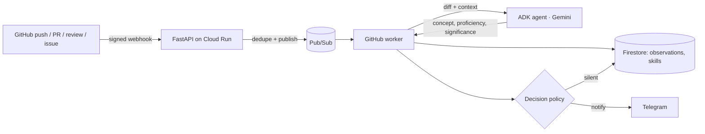

# Mark-I

**A workspace of AI agents you configure yourself, each with its own role, permissions and history.**

The first agent we shipped is a coding mentor. It watches your GitHub activity, keeps a skill map of what you work on, and messages you on Telegram only when something is worth your attention.

Built in a team of two for the Google Cloud *All Things Agentic* hackathon on Devpost.

`FastAPI` · `Google ADK` · `Gemini on Vertex AI` · `Cloud Run` · `Pub/Sub` · `Firestore` · `Next.js 16` · `Firebase Auth` · `Telegram Bot API`

---

## The idea

Most assistants are one generic chat that has to mentor, research, design and plan at once, with one mixed context. Mark-I lets you create several specialised agents instead. Each one has its own instructions, its own access to your data, and its own runs, so outputs always say which agent made them and why.

## What works today

| Area | Status |
|---|---|
| GitHub mentor pipeline: webhook → Pub/Sub → Gemini analysis → skills → decision → Telegram | ✅ Backend, tested |
| Chat with the mentor on the web and in Telegram, with your skills and recent activity as context | ✅ Backend |
| Opportunity digest: Cloud Scheduler pulls Dev.to articles and scores them for each user | ✅ Backend |
| GitHub OAuth, repository selection, webhook registration | ✅ Backend + frontend |
| Telegram account linking (`/start`, `/link <code>`) | ✅ Backend |
| Agent roster, onboarding, run timeline, artifacts and handoffs UI | ✅ Frontend, local preview mode |
| Creating custom agents and running several at once on the backend | 🚧 Designed in [`docs/`](docs/), API not implemented yet |

The hackathon deployment (Firebase Hosting + Cloud Run) has been taken down, so the project runs locally only.

## How the mentor works



1. GitHub sends `push`, `pull_request`, `pull_request_review`, `issues`, `issue_comment` or `create` events. The API checks the `X-Hub-Signature-256` HMAC, drops duplicates and publishes the event to Pub/Sub.
2. A separate worker service fetches the changed code (secrets in patches are redacted first), sends it to an ADK `LlmAgent` on Gemini and gets back a structured observation: which concept, how well it was used, and how significant it is.
3. The worker updates a 0–10 skill score per concept and stores the observation.
4. The model **judges** significance, but the model does not decide whether to message you. That decision is a deterministic policy:

   | Intensity | Notify when significance ≥ |
   |---|---|
   | `chill` | 7 |
   | `normal` | 5 |
   | `brutal` | 3 |

   Some events always notify you: a repeated mistake, a skill score dropping by a point or more, a brand-new concept, or a score crossing 5 or 8. Every decision is stored with its threshold and reason, so you can always see why a message was or wasn't sent.

## Engineering notes

- **Idempotent by design.** GitHub, Pub/Sub and Telegram can all deliver the same thing twice. Processed events, opportunity effects, Telegram updates and deliveries each have their own dedup record, so a retry never sends a second message.
- **The client never writes to the database.** All Firestore writes go through the backend's Admin SDK. [`firestore.rules`](firestore.rules) only lets a signed-in user read their own documents.
- **Secrets stay server-side.** GitHub OAuth tokens and the bot token live in Secret Manager. The frontend only gets browser-safe Firebase config.
- **Frontend is honest about gaps.** Every payload passes a runtime decoder. Features without a backend endpoint fail with an explicit "backend contract unavailable" error instead of showing fake data.
- **Tests.** 308 pytest cases pass in about 20 seconds, including PICT pairwise tests for the auth, GitHub, chat, Telegram and decision paths. A Firestore Emulator suite also runs when the emulator is available.
- **Deploy.** [`cloudbuild.yaml`](backend/cloudbuild.yaml) validates the rollout config, then deploys three Cloud Run services from one image: the API, the GitHub worker and the opportunity worker.

## Repository layout

```text
backend/
  app/            FastAPI app: API v1, webhooks, services, models, worker apps
  ai/             ADK GitHub analyzer, chat agent, prompts, tools
  workers/        GitHub event extractors, escalation rules, opportunity worker
  telegrambot/    Telegram update handling and webhook setup
  tests/          pytest suite (unit, contract, emulator)
frontend/
  app/            Next.js routes: landing, login, onboarding, dashboard, agents, runs, settings
  services/       data layer with Firebase and local-preview adapters
  lib/            API client, runtime decoders, config
docs/             PRD, TRD, architecture, API, Firestore schema, decisions, demo script
openapi.yaml      REST contract shared by both sides
firestore.rules   client read rules
```

## Run locally

### Frontend (no backend needed)

```bash
cd frontend
cp .env.local.example .env.local   # keeps NEXT_PUBLIC_DATA_MODE="local"
npm install
npm run dev                        # http://localhost:3000
```

Local mode stores everything in `localStorage` and simulates agent runs. It is meant for trying out the UI and is refused by production builds.

### Backend

Needs Python 3.11 and a Google Cloud project with Firestore, Pub/Sub and Vertex AI enabled.

```bash
cd backend
python3.11 -m venv .venv
.venv/bin/pip install -r requirements-py311.lock
cp .env.example .env               # GCP project, Telegram bot, GitHub OAuth app
.venv/bin/uvicorn app.main:app --reload --port 8000
```

API docs are served at `http://localhost:8000/docs`.

### Tests

```bash
cd backend
.venv/bin/pip install -r requirements-dev.txt
.venv/bin/python -m pytest
```

The emulator tests are skipped unless `FIRESTORE_EMULATOR_HOST` is set. To include them, run the suite through `firebase emulators:exec`.

## Documentation

- [Product requirements](docs/prd.md) and [technical requirements](docs/trd.md)
- [Architecture](docs/ARCHITECTURE.md): system diagram and request flows
- [API](docs/API.md) and [`openapi.yaml`](openapi.yaml)
- [Firestore schema](docs/FIRESTORE.md) and [event catalog](docs/EVENTS.md)
- [Design decisions](docs/DECISIONS.md)

## Team

- [Yernur](https://github.com/yernururue): backend, AI agents, infrastructure
- [Vlad](https://github.com/vlat247): frontend
